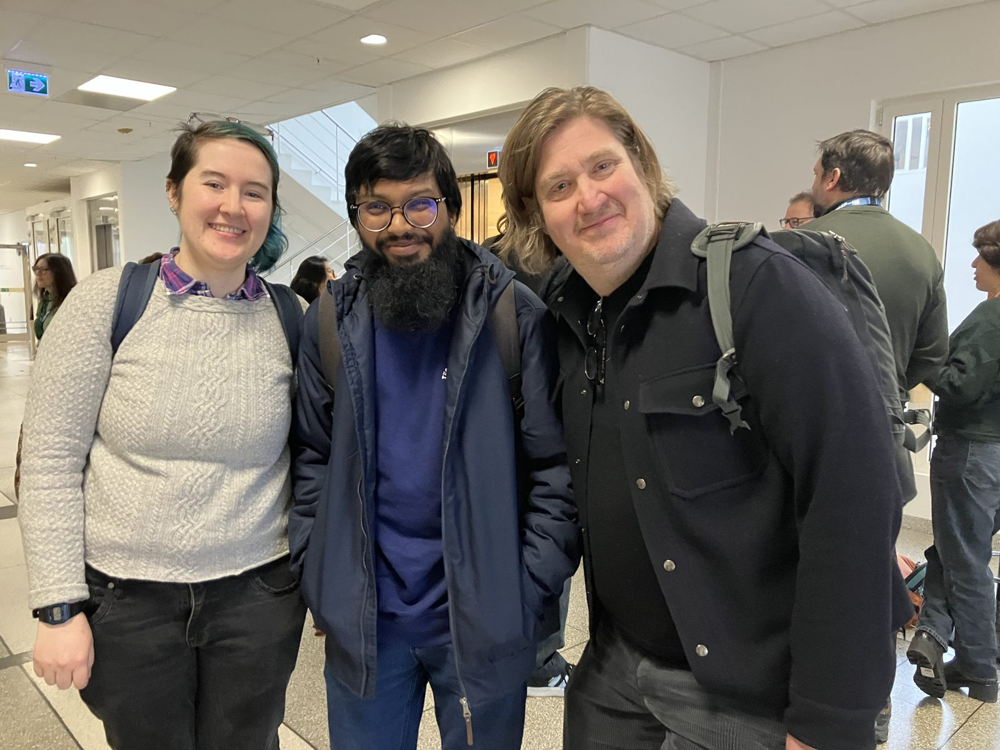
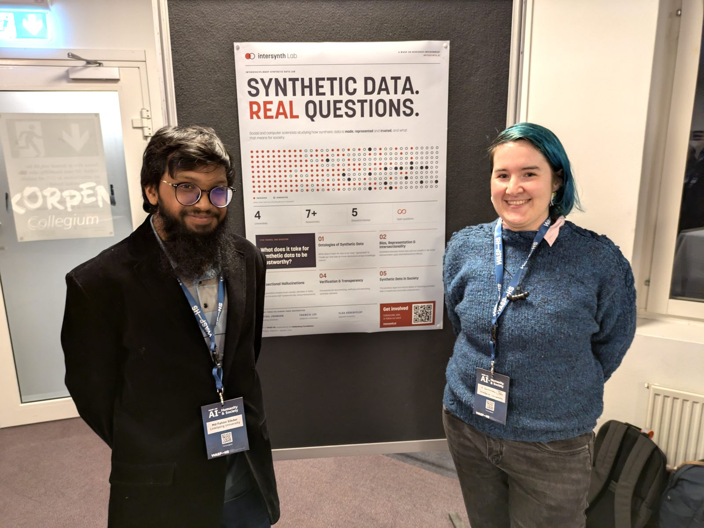

On 10 and 11 November, four researchers from InterSynth Lab attended [AI for Humanity and Society 2026](https://wasp-hs.org/event3/ai-for-humanity-and-society-2026/), the WASP-HS conference: Francis Lee, Ericka Johnson, Md Fahim Sikder and H Devinney. This year, the conference was held at Stångs Mjärdevi in Linköping Science Park, and its theme was "Robots and Autonomous Systems in Everyday Life".

<figure>
  
  <figcaption>Md Fahim Sikder, H Devinney and Francis Lee at the conference.</figcaption>
</figure>

The programme had four panels: coordinating human and robot bodies, educational robots and AI, policy and regulation of robots, and robots and AI in care and crisis. There were also two keynotes. Steve Benford (University of Nottingham) opened with "Somabotics: Creatively Embodying Artificial Intelligence", and Janet Vertesi (Princeton University) closed with "Ten Provocations for the Study and Construction of Human-Robot Teams".

Md Fahim Sikder and H Devinney presented two posters together. The first poster presented InterSynth Lab itself. The second one presented the six postdoctoral projects in the lab, by Alicja Ostrowska, Svea Kiesewetter, Md Fahim Sikder, Vera Danilova, Charlotte Högberg and H Devinney.

<figure>
  
  <figcaption>Md Fahim Sikder and H Devinney with the InterSynth Lab poster.</figcaption>
</figure>

Ericka Johnson presented a cat robot demo at the Interactive Reception on the first evening, where researchers showed live robots and research demonstrations.
